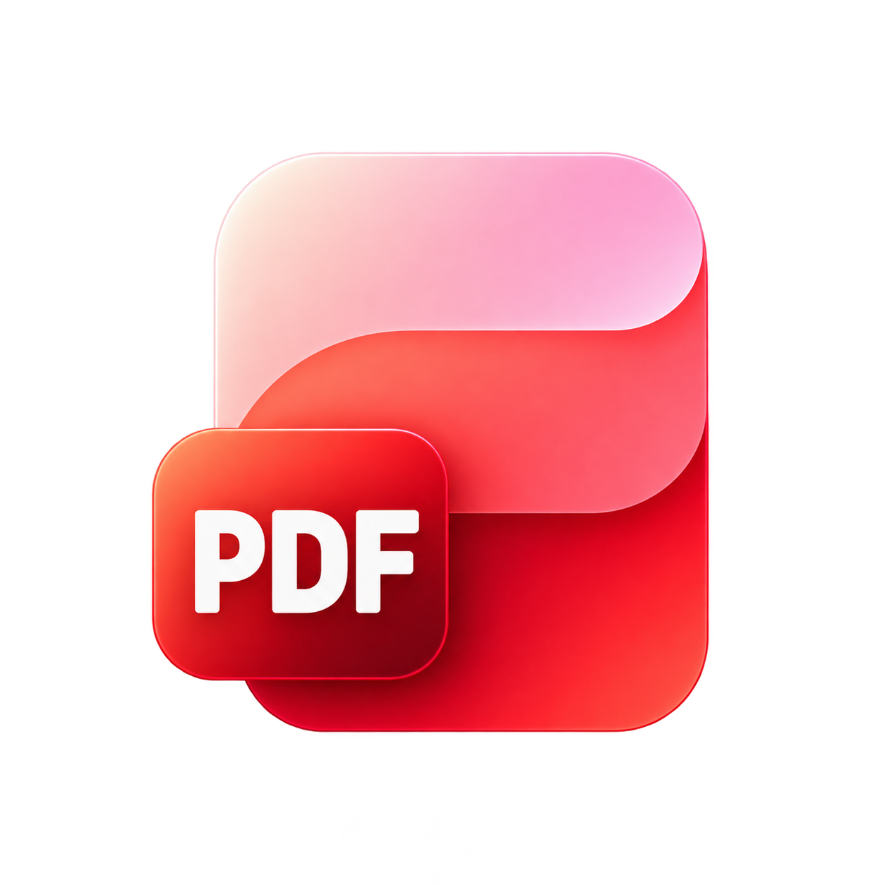
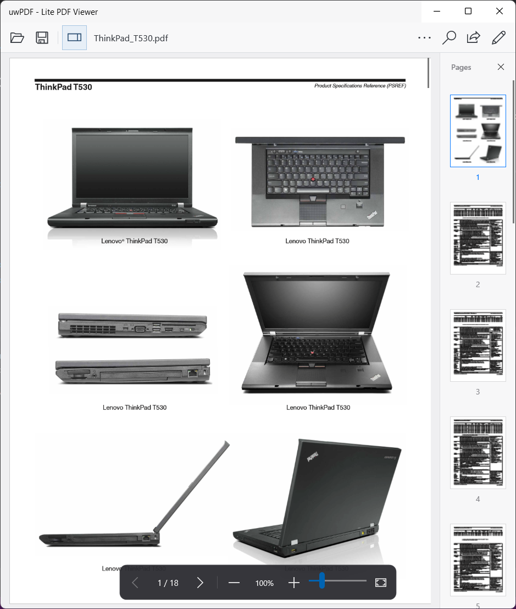
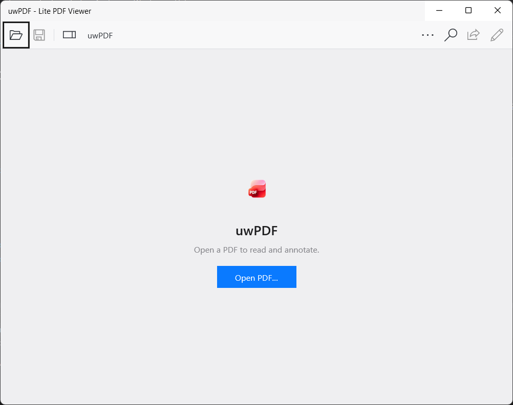
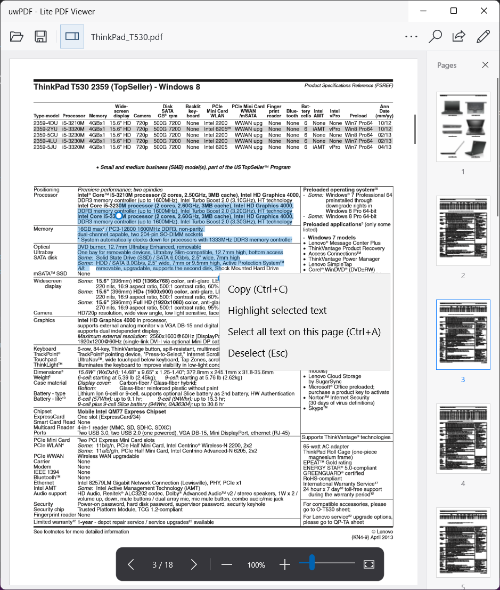
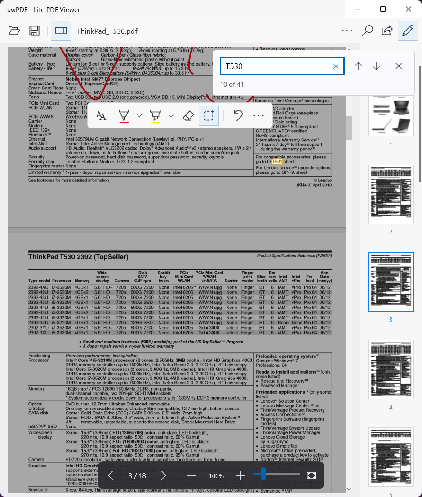
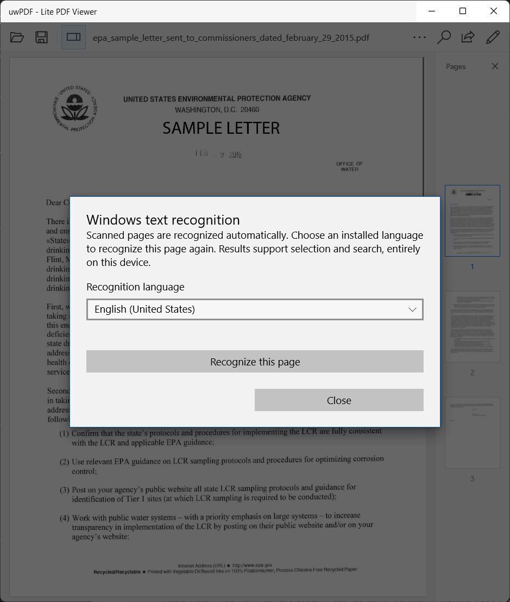
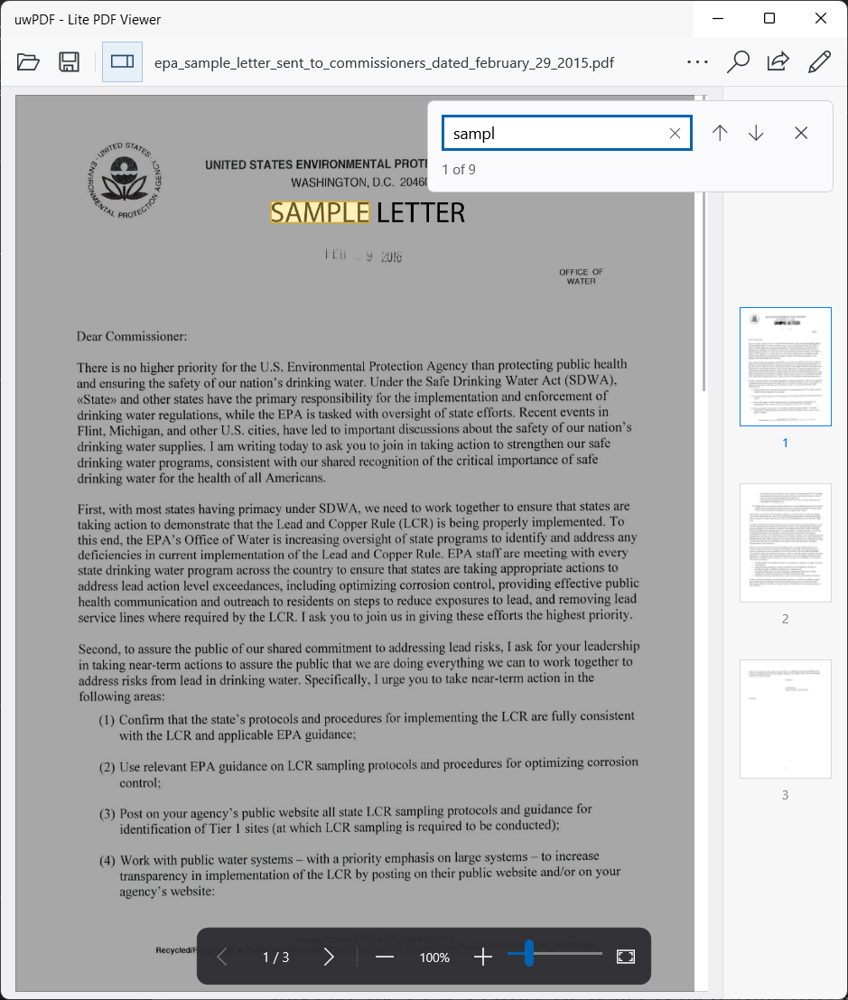
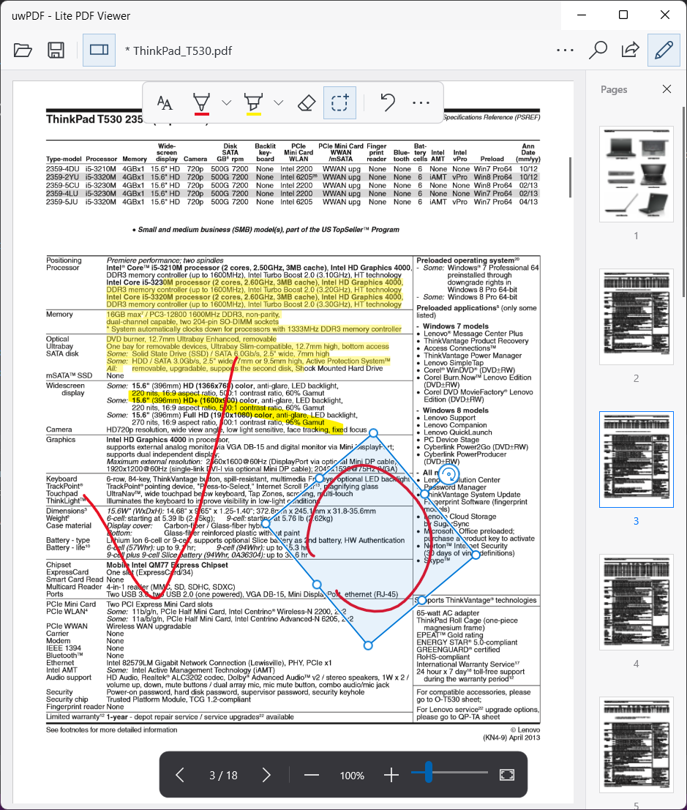
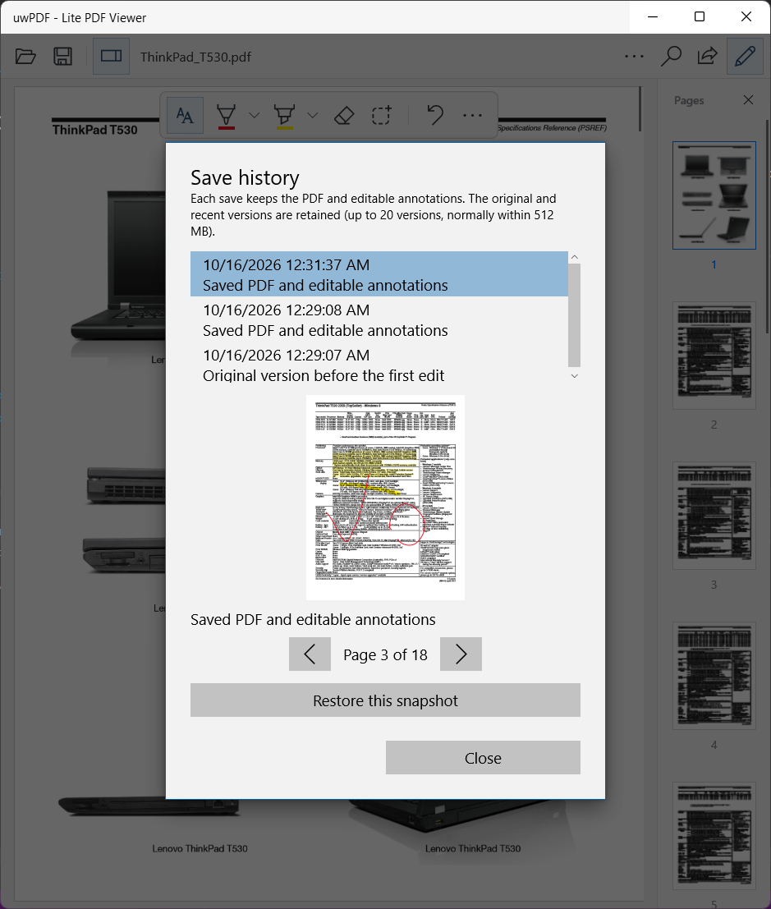
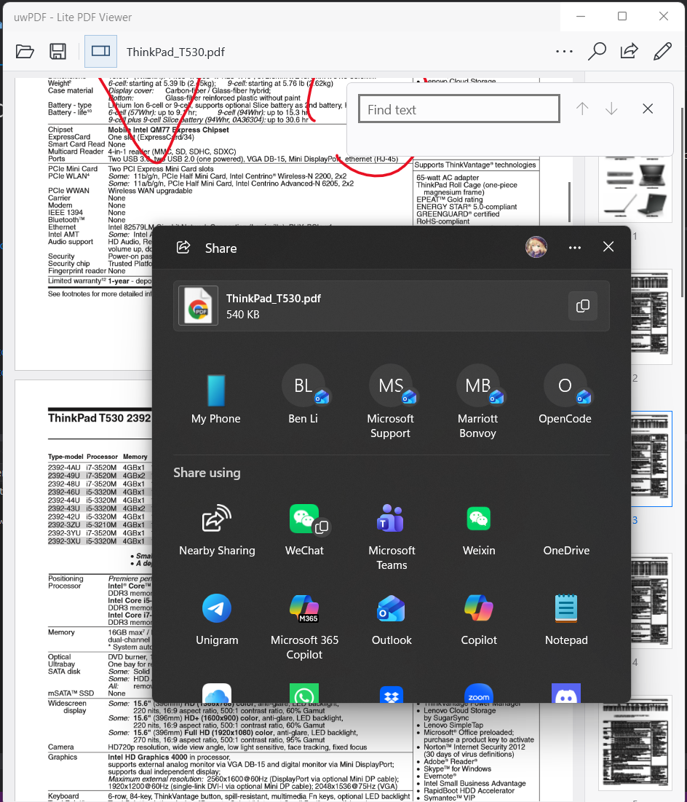

<div align="center">
  

  <h1>uwPDF</h1>

  <p>A lightweight, native PDF reader and ink annotator for Windows.</p>

  <a href="LICENSE"></a>
  <a href="https://github.com/A-BenLi06/uwPDF/releases"></a>
  

  <p><a href="https://github.com/A-BenLi06/uwPDF/releases/latest">Download the latest release</a> · <a href="https://github.com/A-BenLi06/uwPDF/issues">Report an issue</a></p>
</div>

uwPDF is a UWP/XAML application inspired by the original Microsoft Edge PDF experience and the compact presentation of macOS Quick Look. It focuses on reading, selecting text, and writing on PDFs with a pen or mouse.

<p align="center">
  
</p>

## Core Highlights

- **Native Windows components.** System PDF rendering, Windows Ink, native file picking, sharing, and printing.
- **Focused reading interface.** A compact toolbar, page thumbnails, floating annotation tools, and a reading HUD that fades when idle.
- **Rendering on demand.** Pages and thumbnails are virtualized near the viewport, with bounded raster caching and detail rendering for zoomed pages.
- **Local document processing.** PDF rendering, text extraction, OCR, and annotation saving run on the device. OCR requires an installed Windows recognition language.
- **Four interface languages.** English, Simplified Chinese, Traditional Chinese, and Japanese follow Windows language preferences, with English fallback.

## Download & Install

The latest published release is [uwPDF 1.0.12.0](https://github.com/A-BenLi06/uwPDF/releases/tag/v1.0.12.0). It provides signed sideload packages and complete installer ZIPs for four architectures.

| Architecture | Declared minimum Windows version | Recommended download |
| :--- | :--- | :--- |
| x86 | Windows 10 1607 (14393) | [x86 installer ZIP](https://github.com/A-BenLi06/uwPDF/releases/download/v1.0.12.0/uwPDF_1.0.12.0_x86_Install.zip) |
| x64 | Windows 10 1607 (14393) | [x64 installer ZIP](https://github.com/A-BenLi06/uwPDF/releases/download/v1.0.12.0/uwPDF_1.0.12.0_x64_Install.zip) |
| ARM (32-bit) | Windows 10 1607 (14393) | [ARM installer ZIP](https://github.com/A-BenLi06/uwPDF/releases/download/v1.0.12.0/uwPDF_1.0.12.0_ARM_Install.zip) |
| ARM64 | Windows 10 1809 (17763) | [ARM64 installer ZIP](https://github.com/A-BenLi06/uwPDF/releases/download/v1.0.12.0/uwPDF_1.0.12.0_ARM64_Install.zip) |

Windows 11 meets these OS version requirements. These are package minimums; build and package validation do not establish runtime compatibility on every supported device. ARM device testing and Windows 10 Start menu tile appearance remain pending according to the release notes.

1. Download the `_Install.zip` matching your device architecture and extract it completely.
2. Right-click `Add-AppDevPackage.ps1`, choose **Run with PowerShell**, and follow the prompts to install the certificate, dependencies, and application. Windows may request administrator approval or permission to sideload apps.
3. The packages use a self-signed development certificate. For manual installation, trust the supplied public `uwPDF.cer` in **Local Computer → Trusted People** and install the required dependencies before opening the `.appx` or `.msix` package.

The release includes [SHA256SUMS.txt](https://github.com/A-BenLi06/uwPDF/releases/download/v1.0.12.0/SHA256SUMS.txt). Compare your download with its listed SHA-256, for example:

```powershell
Get-FileHash .\uwPDF_1.0.12.0_x64_Install.zip -Algorithm SHA256
```

GitHub downloads use the sideload identity `Ben.LitePdfViewerPreview`. The source also defines the separate Microsoft Store identity `BenLi06.uwPDF-LitePDFViewer`; Store identity configuration alone does not confirm public Store availability.

## Features

### Viewing & Navigation

- Open local PDFs through the file picker or Windows `.pdf` file association.
- Read in a continuous vertical page layout with a thumbnail sidebar and current-page navigation.
- Open documents at 100% logical scale; use manual zoom or whole-page fit. Manual window sizing is retained when opening another file in the same session.
- Select text across pages, double-click a word, copy selections, or select all text on the current page.
- Search document text with highlighted matches, next/previous navigation, and wraparound.
- Use offline Windows OCR for image-only pages, or recognize the current page with a selected installed recognition language. OCR provides text for selection and search; it does not add a searchable text layer to the saved PDF.

| Open a document | Select and copy text |
| :---: | :---: |
| [](docs/screenshots/home-screen.png) | [](docs/screenshots/pdf-text-select.png) |

| Find text | Choose an OCR language |
| :---: | :---: |
| [](docs/screenshots/text-find-tool.png) | [](docs/screenshots/ocr.png) |

<details>
<summary>See search on a scanned page after OCR</summary>



</details>

### Annotations & Markup

- Draw with a pen or mouse using Windows Ink; choose pen/highlighter colors and sizes, erase ink, and undo edits. Touch pans the document.
- Highlight selected PDF text, including selections spanning multiple pages.
- Lasso ink to move, resize, stretch, or rotate it. Hold Shift while rotating to snap to 15-degree increments.
- Save editable ink and text highlights into the current PDF as standard annotations with appearance streams for other readers. uwPDF also keeps local editable annotation data.
- Preview and restore local save-history snapshots. History is stored on the device and is not included when sharing the PDF.

| Ink, highlights, and lasso transforms | Preview and restore save history |
| :---: | :---: |
| [](docs/screenshots/pdf-annotating.png) | [](docs/screenshots/snapshot-and-recall.png) |

### Sharing, Printing & Windows Integration

- Share the PDF through the native Windows sharing interface after saving pending annotations.
- Print with the native Windows print dialog, including page ranges. Printing includes pending ink/highlights without saving the original file.
- On Windows 10, live tiles can show the most recently opened document's thumbnail, filename, page number, and reading progress. Small, medium, wide, and large tile assets are included.

<p align="center">
  
</p>

The current app does not provide tabs, detachable document windows, facing-page layouts, a bookmark tree, a presentation mode, text editing, underline/strikethrough tools, sticky notes, page reordering/extraction, split/merge tools, or image export.

### Keyboard Shortcuts

| Shortcut | Action |
| :--- | :--- |
| `Ctrl+O` | Open a PDF |
| `Ctrl+F` | Search |
| `Enter` / `Shift+Enter` in search | Next / previous match |
| `Ctrl+C` | Copy selected text |
| `Ctrl+A` | Select all text on the current page |
| `Ctrl+S` | Save annotations |
| `Ctrl+P` | Print |
| `Ctrl+Z` with ink selected | Undo an ink edit |
| `Space`, `Page Down`, `→`, `↓` | Next page |
| `Backspace`, `Page Up`, `←`, `↑` | Previous page |
| `Home` / `End` | First / last page |
| `+` / `-` | Zoom in / out |
| `0` | Fit the current page |
| `Esc` | Deselect or cancel an active ink transform |

Text fields retain their normal editing behavior.

## How to Build from Source

This repository uses a mixed toolchain. A modern .NET SDK alone is insufficient; the existing UWP projects are built with Windows MSBuild, UWP XAML tools, and .NET Native.

### Prerequisites

- A Windows development machine with Git, PowerShell, and NuGet restore support.
- **x86/x64/ARM32 application:** Visual Studio 2015 UWP tooling / MSBuild 14, Windows SDK **10.0.14393.0**, and the existing .NET Native tools. The project uses `Microsoft.NETCore.UniversalWindowsPlatform` **5.1.0**.
- **Default native bridge:** modern MSVC architecture tools and Windows SDK **10.0.26100.0** for the C++/WinRT component. ARM32 additionally requires the pinned local toolchain prepared by `Prepare-CppWinRTArm32.ps1`.
- **ARM64 application:** the separate solution uses UWP **6.2.14**, .NET Native **2.2**, SDK **26100**, and VS **2026 UWP XAML tools** with the repository's local target/toolchain preparation scripts.

### x64 Example

Clone the repository, then use the bundled NuGet restore tool:

```powershell
git clone https://github.com/A-BenLi06/uwPDF.git
cd uwPDF
.\.tools\nuget-3.5.0.exe restore .\LitePdfViewer.sln -ConfigFile .\NuGet.Config
.\scripts\Prepare-NativeDependencies.ps1
& 'C:\Program Files (x86)\MSBuild\14.0\Bin\MSBuild.exe' .\LitePdfViewer.sln /p:Configuration=Debug /p:Platform=x64
```

Open `LitePdfViewer.sln` in the matching UWP development environment to deploy and debug. The default build invokes `Build-CppWinRT.ps1` for the native component. For x86 use `/p:Platform=x86`; for ARM32 first run `Prepare-CppWinRTArm32.ps1`, then use `/p:Platform=ARM`.

For a signed local Release build, explicitly select the development identity:

```powershell
& 'C:\Program Files (x86)\MSBuild\14.0\Bin\MSBuild.exe' .\LitePdfViewer.sln /p:Configuration=Release /p:Platform=x64 /p:UseStoreIdentity=false
```

Release defaults to `UseStoreIdentity=true` and disables local signing for the Store identity. Local signing requires a matching development certificate; private signing material must stay out of published assets. Store submission containers (`.appxupload` / `.msixupload`) are not GitHub installers.

### ARM64

```powershell
.\scripts\Prepare-NativeDependencies.ps1
.\scripts\Prepare-CppWinRTArm64.ps1
.\scripts\Prepare-UwpArm64Targets.ps1
.\scripts\Build-UwpArm64.ps1 -Configuration Release
```

This builds `LitePdfViewer.ARM64.sln` with the separate ARM64 project and manifest. Its Release configuration defaults to the unsigned Store identity; the command above does not produce the signed GitHub sideload installer by itself.

See [DEVELOPMENT.md](DEVELOPMENT.md) for detailed toolchain, bridge, packaging, diagnostics, and test instructions.

## Technical Details & Third-Party Components

The UI is a C# UWP/XAML application organized into partial `MainPage` implementations and supporting services. The default native bridge is C++/WinRT; an optional legacy C++/CX bridge remains for x86/x64/ARM32. This is not a WinUI 3 or Windows App SDK project.

| Component | Role | License / notice |
| :--- | :--- | :--- |
| Windows.Data.Pdf / IPdfRendererNative | System PDF rendering through a shared DirectX 11 core, with bitmap fallback | Windows platform component |
| Windows Ink, Windows.Media.Ocr, UWP XAML | Input, offline OCR, and native controls | Windows platform components |
| C++/WinRT | Native WinRT bridge and generated projections | MIT; pinned ARM32 tooling notice is packaged |
| MuPDF 1.28.5 | PDF text geometry and annotation writing; not the viewer's page renderer | AGPL-3.0-or-later or a separately obtained commercial license |
| FreeType, jbig2dec, IJG JPEG, zlib, bundled fonts | Native document-engine dependencies | Individual notices in [THIRD-PARTY.md](THIRD-PARTY.md) and packaged licenses |

No PDFium, Win2D, CommunityToolkit.Mvvm, PdfSharp, or iText dependency is used by the current application. The former PDF.js text bridge is no longer packaged.

## Verification & Known Limits

The [1.0.12.0 release notes](https://github.com/A-BenLi06/uwPDF/releases/tag/v1.0.12.0) identify build source [`689f2d9`](https://github.com/A-BenLi06/uwPDF/commit/689f2d9b8324c3ba58b25dce4c43d90c6fe3c9d5). The tag resolves to that commit, which is included in `main`. All four release architectures are reported as Release/.NET Native builds with package signature, content-hash, native architecture, and component-registration checks.

[VERIFICATION.md](VERIFICATION.md) records the scope and limitations of earlier acceptance work. The repository includes native component tests, production-method tests with platform doubles, package checks, and localization checks. These do not by themselves prove physical pen/touch latency, GPU presentation quality, total memory use, or compatibility on older Windows and ARM devices. The normal raster-cache budget is up to 64 MiB; it is not a total-process memory limit.

## Contributing

Bug reports, feature requests, and pull requests are welcome. Include the application version, Windows build, device architecture, reproduction steps, and a sample PDF when it can be shared.

1. Fork the repository and create a feature branch.
2. Make a focused change and run the relevant checks in [DEVELOPMENT.md](DEVELOPMENT.md).
3. Open a pull request describing the behavior change and validation performed.

## Copyright & License

Copyright (c) 2026 BenLi06.

uwPDF's own source is licensed under the [MIT License](LICENSE). Third-party components retain their respective licenses. Builds containing MuPDF must comply with its AGPL-3.0-or-later terms or a separately obtained commercial license; the project's MIT license does not replace those obligations. See [THIRD-PARTY.md](THIRD-PARTY.md) for versions, notices, and source information.
